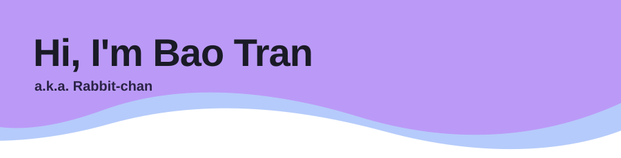
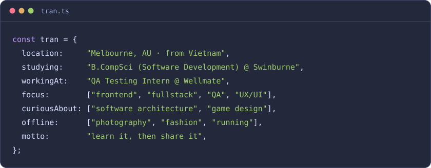

<!-- Header -->

 

 

| | |
|---|---|
| **frontend** |        |
| **backend & data** |      |
| **testing** |    |
| **design & ship** |       |

 

> _"Any fool can write code that a computer can understand. Good programmers write code that humans can understand."_
> — Martin Fowler, _Refactoring_

`// open to internships & grad roles in frontend, fullstack and QA`

<!-- Footer -->

